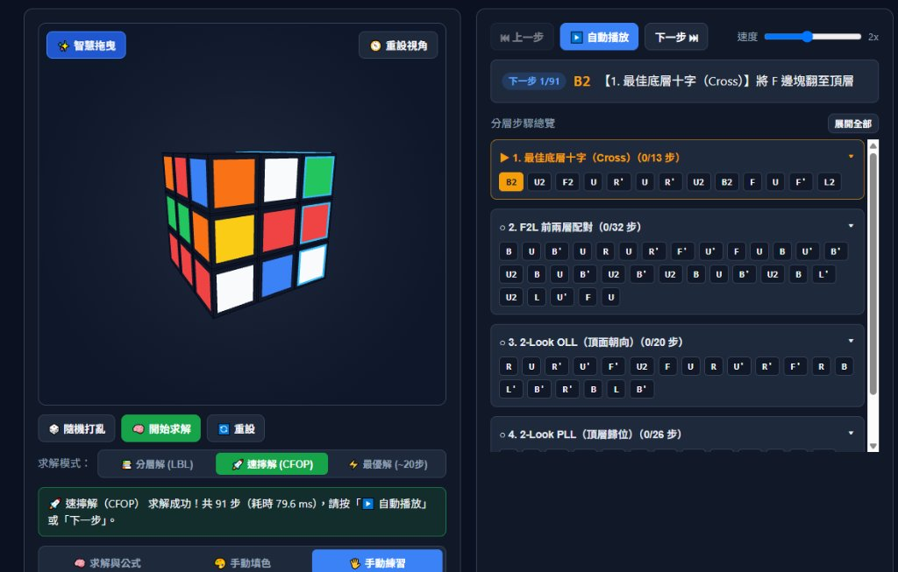

# 🧊 3D Rubik's Cube Step-by-Step Solver

Zero-dependency 3D Canvas Rubik's Cube interactive solver and trainer. Runs directly in any browser (`index.html`), including offline via `file://`.

**[Live Demo](https://frankzhao-io.github.io/rubiks-cube-solver/)**

## Features

- **3 Solving Modes**:
  - **LBL (`js/solver.js`)**: Human-readable 7-stage Layer-by-Layer beginner tutorial (~130 moves).
  - **CFOP (`js/solver-cfop.js`)**: Optimal Cross + F2L pairing + 2-Look OLL & 2-Look PLL (~70–100 moves with named algorithms).
  - **Kociemba Two-Phase (`js/solver-optimal.js`)**: Pure-JS Two-Phase IDA* optimal solver (~18–22 moves).
- **Interactive 3D Canvas (`js/renderer3d.js`)**:
  - **Smart Drag**: Drag any sticker (including middle slices `M / E / S`) for real-time slice turning with auto-snap; drag background or right-click to orbit the camera.
  - **Step Playback**: Play/pause, step forward/backward, speed slider, active-layer cyan highlight, and collapsible phase accordion.
- **Paint & Solvability Validation (`js/cube.js`)**:
  - Paint directly on 3D stickers or the 2D unfolded net (with `1–6` swatch shortcuts and per-face fill), plus full parity/orientation solvability checks.
- **Formula Input & Manual Practice (`js/app.js`)**:
  - Apply custom scrambles/algorithms (`U D R L F B M E S` with `'` and `2`), keyboard shortcuts, and manual move history with undo.

## Usage

Open `index.html` in a modern browser.
